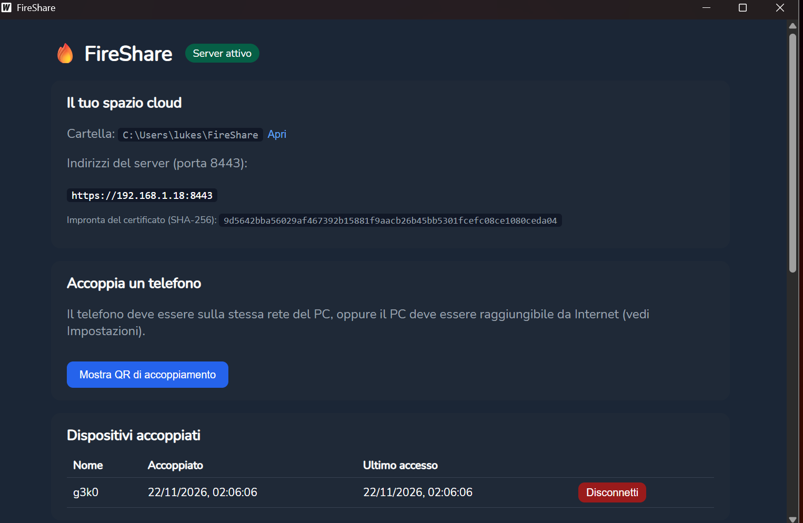
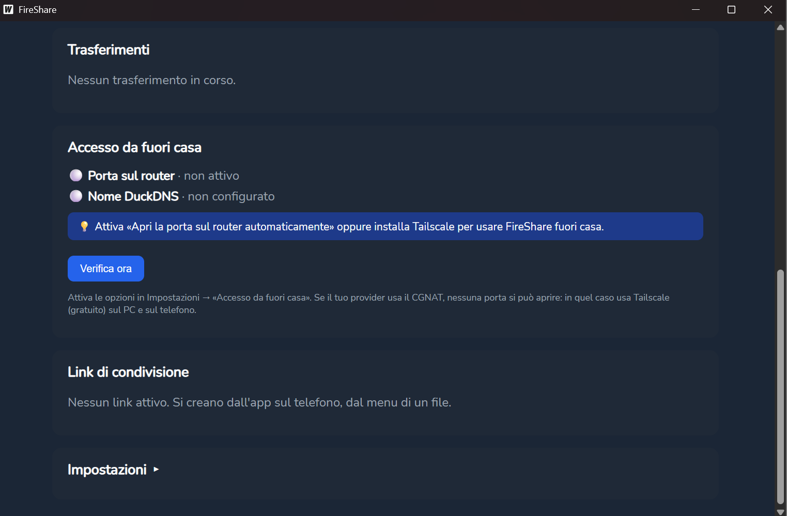
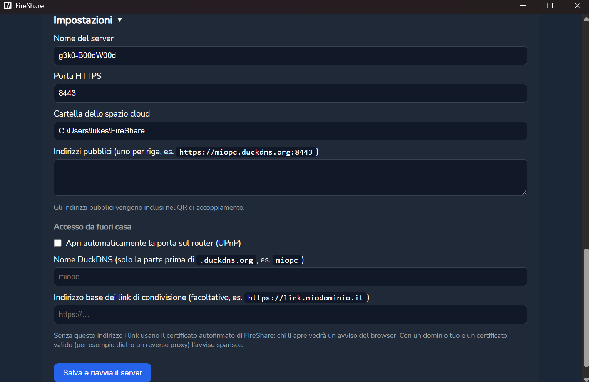
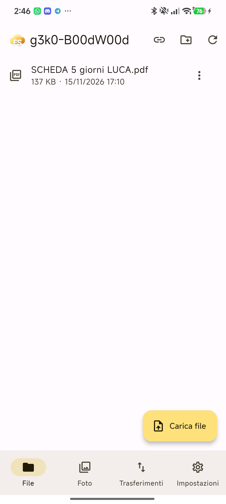
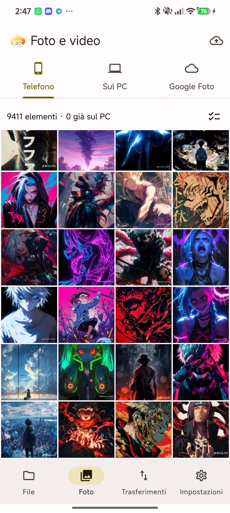
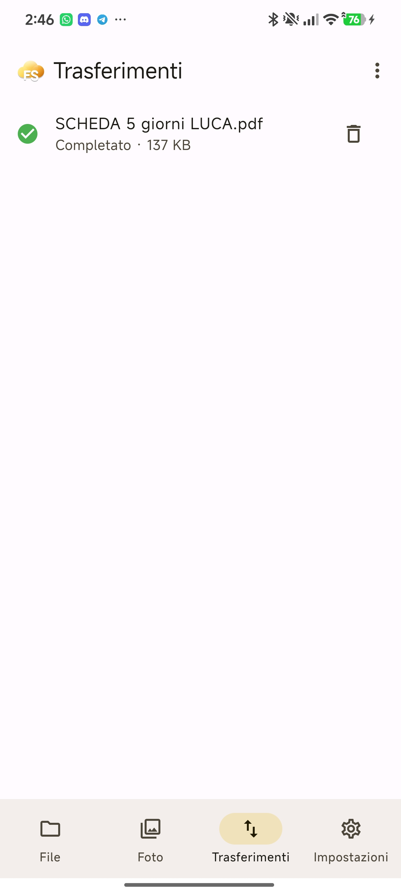
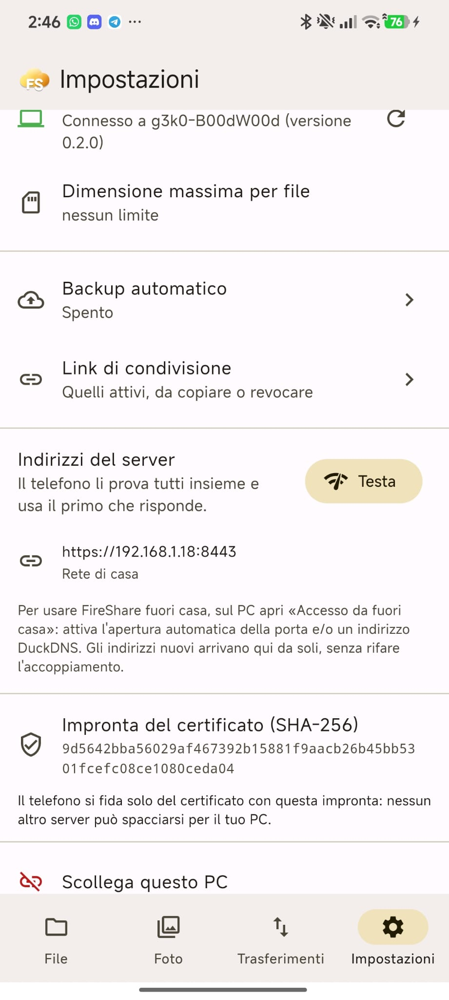

<div align="center">


# FireShare

**Il tuo cloud personale, sul tuo PC.**
Carica foto, video e file dal telefono sul tuo computer, senza abbonamenti a servizi di terze parti.

<br>


<br>

[Panoramica](#panoramica) ·
[Screenshot](#screenshot) ·
[Funzioni](#funzioni) ·
[Come funziona](#come-funziona) ·
[Installazione](#installazione) ·
[Architettura](#architettura-android) ·
[API](#riferimento-api)

</div>

---

## Panoramica

FireShare è una soluzione per costruirsi un proprio cloud self-hosted. Oggi la maggior parte dei computer, sia desktop sia laptop, ha una grande capacità di archiviazione che molte volte rimane inutilizzata. FireShare nasce per evitare questo spreco e per non pagare un servizio di terze parti, puntando su un'interfaccia semplice e intuitiva.

L'applicazione per dispositivi mobili è per ora disponibile solo per **Android**, ma lo sviluppo di una versione per **iOS** è già previsto. Il progetto è stato sviluppato come tesi di laurea.

| Componente | Tecnologia | Ruolo |
| --- | --- | --- |
| **Server** | Go | gestisce accoppiamento, upload, download, galleria e link di condivisione |
| **App desktop** | Wails + Vue | interfaccia del server sul PC (stato, QR di accoppiamento, impostazioni) |
| **Client mobile** | Flutter / Dart (Material 3) | app Android che parla con il server |

<details>
<summary><b>Perché Go per il server</b></summary>

<br>

- **Libreria standard completa:** le librerie che ci servono sono già tutte incluse.
- **Concorrenza semplice:** le goroutine sono facili da usare e ottime per gestire più upload contemporaneamente.
- **Portabilità:** Windows (da Windows 10 in poi), macOS e Linux.

</details>

<details>
<summary><b>Perché Dart e Flutter per il client</b></summary>

<br>

- Tecnologie moderne, con la possibilità di usare un'interfaccia aggiornata (**Material 3**).
- Un buon ecosistema di plugin: fotocamera/QR, galleria, notifiche, attività in background.
- Una community molto attiva.
- Lo sviluppo a widget rende il lavoro più leggero e piacevole.

</details>

---

## Screenshot

### Server (PC)

<p align="center">
  <br>
  <sub><b>Home del server:</b> stato, cartella del cloud, indirizzi, impronta del certificato, accoppiamento e dispositivi accoppiati.</sub>
</p>

<p align="center">
  <br>
  <sub><b>Trasferimenti, accesso da fuori casa e link di condivisione.</b></sub>
</p>

<p align="center">
  <br>
  <sub><b>Impostazioni:</b> nome del server, porta, cartella, indirizzi pubblici, UPnP e DuckDNS.</sub>
</p>

### Client (Android)

<table align="center">
  <tr>
    <td align="center"><br><sub><b>File</b><br>esplora le cartelle del PC</sub></td>
    <td align="center"><br><sub><b>Foto e video</b><br>Telefono · Sul PC · Google Foto</sub></td>
    <td align="center"><br><sub><b>Trasferimenti</b><br>coda di upload e download</sub></td>
    <td align="center"><br><sub><b>Impostazioni</b><br>indirizzi e certificato</sub></td>
  </tr>
</table>

---

## Funzioni

| | Funzione | Stato |
| :-: | --- | :-: |
| 🔐 | Accoppiamento sicuro dei dispositivi | ✅ |
| ⬆️ | Upload affidabile (riprende da dove si era interrotto) | ✅ |
| ⬇️ | Download affidabile | ✅ |
| 💾 | Backup, sia manuale sia automatico | ✅ |
| 🧹 | Carica e libera spazio | ✅ |
| 🖼️ | Galleria remota («Sul PC») | ✅ |
| 🔗 | Link di condivisione temporanei | ✅ |
| 🚪 | Accesso da fuori casa | ✅ |
| 📸 | Importazione da Google Foto | ✅ |
| 🍎 | Versione per dispositivi iOS | ❌ |
| 🗑️ | Cancellazione automatica di foto e video su Google Foto | ❌ |

> [!NOTE]
> L'ultima voce non è realizzabile con le API attuali di Google Foto, che non permettono di eliminare elementi dalla libreria dell'utente.

---

## Come funziona

### 🔐 Accoppiamento sicuro dei dispositivi

1. Il PC mostra un **QR**, il telefono lo scansiona.
2. Nel QR c'è un **codice temporaneo**: il telefono lo legge e lo rimanda al server.
3. Il server confronta i due codici. Se corrispondono, rilascia un **token**, usato poi per accesso, upload e download.
4. Il token è salvato **come hash** sul server e nel **keystore di Android** sul telefono.

### ⬆️⬇️ Upload e download affidabili

Quando inizia un upload o un download vengono creati dei **metafile** in cui è registrato lo stato di avanzamento. Se l'operazione viene interrotta, alla ripresa non si riparte da zero ma da dove ci si era fermati.

Per ogni file viene inoltre calcolata una firma **SHA-256**. A operazione conclusa la firma viene ricalcolata e confrontata con quella di partenza: se combacia l'operazione è riuscita, altrimenti riparte da zero.

### 💾 Backup e libera spazio

Si può impostare un **backup automatico** di foto e video, come con Google Foto, oppure lasciarlo **manuale**. La funzione **libera spazio** cancella dalla memoria del telefono il file già caricato.

### 🖼️ Galleria remota

Permette di vedere foto e video che sono già stati caricati sul cloud (scheda **Sul PC**).

### 🔗 Link di condivisione temporanei

Per ogni file caricato si può generare un link da cui scaricare direttamente la risorsa. Il link ha una scadenza: passato il tempo limite viene invalidato automaticamente.

### 🚪 Accesso da fuori casa

Per raggiungere il server anche fuori dalla rete domestica si può:

- usare un servizio di DNS gratuito come **DuckDNS**, associando un nome al proprio indirizzo pubblico e impostandolo anche sul client;
- far aprire automaticamente la porta sul router (**UPnP**);
- se il provider usa il CGNAT (nessuna porta si può aprire), usare **Tailscale**, gratuito, sul PC e sul telefono.

### 📸 Importazione da Google Foto

Si può collegare il proprio account Google per trasferire le foto salvate su Google nel proprio spazio cloud privato.

---

## Installazione

### Windows + Android: installazione rapida

> [!NOTE]
> Gli eseguibili (`.exe`, `.apk`) non sono inclusi nel repository perché vengono ignorati da `.gitignore`. Si ottengono compilando il progetto (sezioni seguenti) oppure, se pubblicati, dalla sezione **Releases** del repository.

1. Avviare il server: `FireShare/go-backend/cmd/desktop/build/bin/desktop.exe`
2. Installare il client sul telefono: `FireShare/flutter_client/build/app/outputs/flutter-apk/app-debug.apk`
3. Nell'app sul PC premere **Mostra QR di accoppiamento**.
4. Nell'app sul telefono scansionare il QR per accoppiare il dispositivo.

### Windows + Android: compilare e installare

**Requisiti**

- Windows 10/11
- Go 1.25 o successivo
- Node.js 20.19 o successivo
- Wails CLI v2.13
- WebView2 (già incluso in Windows 11 e Windows 10)
- JDK 17
- Flutter SDK 3.19.3
- Android 6.0 o successivo sul telefono
- Android SDK API 34
- Android SDK Build-Tools 30.0.3

**1. Compilare il server**

```bash
go install github.com/wailsapp/wails/v2/cmd/wails@v2.13.0
cd FireShare/go-backend/cmd/desktop
wails doctor      # controlla che gli strumenti per la compilazione ci siano
wails build       # crea l'eseguibile in build/bin
```

**2. Compilare l'app Android**

> [!WARNING]
> Il file `FireShare/flutter_client/android/gradle.properties` contiene una riga specifica del PC di sviluppo:
>
> `org.gradle.java.home=C:/Program Files/Microsoft/jdk-17.0.21.21-hotspot`
>
> Serve a forzare la JDK 17 per Gradle. Va **eliminata** o **corretta** con il percorso della propria JDK 17. Se la JDK 17 non è quella predefinita per Flutter, si può indicare con `flutter config --jdk-dir <percorso>`.

```bash
cd FireShare/flutter_client
flutter doctor --android-licenses     # dopo aver installato Android Studio e l'SDK
flutter pub get
flutter build apk
```

L'APK si trova in `FireShare/flutter_client/build/app/outputs/flutter-apk/app-debug.apk`.

### macOS + Android: compilare e installare

**Requisiti**

- JDK 17
- Flutter SDK 3.19.3
- Android 6.0 o successivo sul telefono
- Go 1.25 o successivo per l'app desktop
- Android SDK API 34
- Android SDK Build-Tools 30.0.3

**1. Compilare il server**

```bash
xcode-select --install                 # strumenti da riga di comando Apple

brew install go                        # serve Homebrew (brew.sh); in alternativa scaricare Go da go.dev
brew install node                      # serve Node 20.19 o successivo

go install github.com/wailsapp/wails/v2/cmd/wails@v2.13.0
echo 'export PATH=$PATH:$HOME/go/bin' >> ~/.zshrc && source ~/.zshrc

wails doctor                           # elenca cosa manca

cd FireShare/go-backend/cmd/desktop
wails build                            # per Intel e Apple Silicon insieme: wails build -platform darwin/universal
```

Il risultato è `build/bin/desktop.app`.

Se macOS la blocca perché non è firmata: tasto destro → **Apri** → conferma, oppure da terminale `xattr -cr build/bin/desktop.app`. Quando richiesto, consentire le connessioni in entrata.

**2. Compilare l'app Android**

```bash
brew install --cask temurin@17         # JDK 17
git clone https://github.com/flutter/flutter.git -b 3.19.3 ~/flutter
export PATH="$PATH:$HOME/flutter/bin"
flutter doctor --android-licenses      # dopo aver installato Android Studio e l'SDK
cd FireShare/flutter_client
flutter pub get && flutter build apk --debug
```

> [!WARNING]
> Anche qui vale l'avviso su `org.gradle.java.home` in `gradle.properties`: la riga con il percorso Windows va eliminata o sostituita con il percorso della propria JDK 17.

---

## Architettura Android

```text
lib/
├─ main.dart                      avvio, tema, scelta schermata iniziale
├─ core/                          logica senza interfaccia (riusabile, testabile)
│  ├─ api/        fireshare_client.dart, pairing_payload.dart
│  ├─ storage/    connection_manager.dart
│  ├─ transfer/   upload_queue.dart, background_keeper.dart
│  ├─ backup/     auto_backup.dart
│  ├─ util/       format.dart
│  └─ ui/         app_logo_title.dart
└─ features/                      una cartella per funzione, con le sue schermate
   home · pairing · files · photos · backup · transfers · settings · splash
```

`core/` non conosce l'interfaccia grafica, mentre `features/` sì. Le schermate non parlano mai direttamente con la rete: usano `ConnectionManager.instance.client` o `UploadQueue`, che comunicano al posto loro. In questo modo il codice è riutilizzabile e la grafica si può cambiare senza toccare i protocolli di rete.

**Gestione dello stato.** Si usa il pattern *publish/subscribe*. Gli oggetti che vivono per tutta la durata dell'app (`ConnectionManager`, `UploadQueue`, `AutoBackup`, `GoogleImportJob`) estendono `ChangeNotifier` e, quando cambiano, chiamano `notifyListeners()`. Le schermate si «iscrivono» con `addListener` o `ListenableBuilder` e si ridisegnano quando ricevono la notifica.

<details>
<summary><b>Funzioni di core (logica interna)</b></summary>

<br>

#### `main.dart`

- `BackgroundKeeper.init()` configura la coda degli upload.
- `Workmanager().initialize(backupCallbackDispatcher, ...)` registra la funzione che Android eseguirà in un processo separato per il backup periodico. È racchiuso in `try/catch`: se fallisce, l'app funziona lo stesso.
- Carica in ordine `ConnectionManager`, `UploadQueue`, `AutoBackup` (leggono i file e il Keystore salvati).
- Dopo `runApp` (così l'interfaccia compare subito): `UploadQueue.kick()` riprende gli upload interrotti, `refreshUrls()` aggiorna gli indirizzi del PC, `scanIfDue()` cerca foto nuove. Sono lanciati con `unawaited(...)`, cioè «non aspettare il risultato».

#### `core/storage/connection_manager.dart`: l'accoppiamento sul telefono

- **`flutter_secure_storage` con `encryptedSharedPreferences: true`:** token, certificato, indirizzi e id del dispositivo sono salvati cifrati, con una chiave tenuta nell'**Android Keystore**.
- `ServerConnection`: nome del server, certificato, lista di URL, token, id del dispositivo.
- `load()` legge dallo storage.
- `_set()` chiude il client precedente, crea il nuovo `FireShareClient` e chiama `notifyListeners()`, così `main.dart` cambia schermata.
- `pair()` crea un client **anonimo** con l'impronta del QR, chiama `pair` e solo in caso di successo salva e attiva la connessione. Il client anonimo viene chiuso in un `finally`.
- **`mergeUrls`:** quando il PC comunica nuovi indirizzi li **aggiunge** senza mai toglierne (massimo 8), li valida con `_cleanUrl` (solo `https`, host non vuoto) e ricrea il client **solo se qualcosa è cambiato**, altrimenti interromperebbe i trasferimenti in corso.
- `removeUrl` (ne resta sempre almeno uno), `refreshUrls` (chiede `info()` al PC; se non risponde non succede nulla), `unpair` (prova a revocare il token sul PC con `DELETE /me`; **se il PC è spento scollega comunque in locale**).

#### `core/transfer/upload_queue.dart`: la coda di upload

L'obiettivo principale è che un trasferimento sopravviva a chiusura dell'app, perdita di rete e riavvio del telefono, senza caricare due volte lo stesso file.

- **`UploadTask`** (un file in coda): `id`, `name`, `dir` (cartella di destinazione sul PC), `clientKey` (token) e la sorgente: `path` (file del telefono), `size`, `sent`, `sha256`, `serverId`, `modifiedAt`, `deleteSource` (se `true`, il file è temporaneo e va cancellato a upload concluso, come nel caso di Google Foto), `state`, `error`, `remotePath`, `phase`.
- **`TaskState`:** `in coda → in esecuzione → completato | fallito | cancellato`.
- **`assetKey(a)` = `ph:<id>:<modifiedDateSecond>`.** La chiave è generata dall'id della foto e dalla sua data di modifica, quindi identifica **l'elemento in una certa versione**: se la foto viene ritoccata la data cambia e viene ricaricata; se non cambia, il PC la riconosce e non la riceve di nuovo.

</details>

<details>
<summary><b>Schermate dell'app (cosa fa ciascuna)</b></summary>

<br>

#### Navigazione: `features/home/home_page.dart`

`HomePage` contiene una `NavigationBar` (Material 3) con 4 destinazioni: **File**, **Foto**, **Trasferimenti**, **Impostazioni**. Le pagine stanno in un **`IndexedStack`**: restano tutte costruite e mantengono posizione di scorrimento e stato quando si cambia scheda. Sull'icona Trasferimenti un `Badge` mostra `pending + failed`. Con `WidgetsBindingObserver.didChangeAppLifecycleState(resumed)`, quando l'app torna in primo piano aggiorna gli indirizzi, cerca foto nuove e riprende la coda. `Permission.notification.request()` chiede il permesso per le notifiche (Android 13+).

#### Accoppiamento: `features/pairing/pairing_page.dart`

Campo per il nome del telefono (default «Telefono Android»), scanner `MobileScanner` (solo formato QR) e, in alternativa, **incolla manuale del link** (`Clipboard.getData`) per quando la fotocamera non funziona.

#### File: `features/files/*`

- **`files_page.dart`:** esplora le cartelle del PC. Titolo con logo nella radice (`AppLogoTitle`) o nome della cartella nelle sottocartelle (con freccia indietro). Azioni: caricare file (`file_picker` → `enqueueFiles`), nuova cartella, rinomina (usa `move`), elimina (con conferma), scarica, apri (`open_filex`), condividi (`share_plus`), **crea link temporaneo**.
- **`remote_download.dart`:** `downloadRemoteToTemp` scarica in una cartella temporanea in un file `.part` e lo rinomina a fine download, così il nome definitivo compare solo quando il file è completo. Mostra un dialogo con progresso e pulsante Annulla.
- **`share_dialog.dart`:** scelta della durata (da 1 minuto a 30 giorni), limite di download e password opzionale. Mostra il link con «Copia» e «Condividi». Se `trustedUrl` è falso avvisa che chi lo riceve vedrà un avviso di certificato.
- **`shares_page.dart`:** elenco dei link attivi con scadenza (`formatRemaining`), download effettuati e pulsante **Revoca**.

#### Backup: `features/backup/backup_page.dart`

Interruttore principale (all'accensione chiede se includere anche le foto già presenti), elenco degli album selezionabili (`listAlbums`), opzioni «solo Wi-Fi» e «solo in carica», pulsante **Controlla ora** (`scan`) e riga di stato con data e risultato dell'ultimo controllo.

#### Trasferimenti: `features/transfers/transfers_page.dart`

Elenco dei task con `LinearProgressIndicator` (valore `progress`), fase, errore e azioni per stato: annulla, riprova, rimuovi. In alto: «riprova tutti i falliti» e «pulisci completati». Si ridisegna con `ListenableBuilder` sulla coda.

#### Impostazioni: `features/settings/settings_page.dart`

Mostra il PC collegato, la **lista degli indirizzi** con icona per tipo (`networkKindOf`) e risultato del test (`probeAll`: tempo di risposta o errore, distinguendo «certificato diverso» da «irraggiungibile»), la possibilità di rimuovere un indirizzo, il controllo di `info()` (versione, limite file), **Scollega** (con conferma) e l'accesso a «Link di condivisione».

</details>

---

## Riferimento API

Prefisso `/api/v1`. «Auth» indica che serve l'intestazione `Authorization: Bearer <token>`.

| Metodo e percorso | Auth | Scopo |
| --- | :-: | --- |
| `GET /health` | no | il server risponde? (serve a scegliere l'indirizzo) |
| `POST /pair` | no (codice nel corpo) | scambia il codice monouso con un token |
| `GET /info` | sì | nome, versione, limite file, elenco indirizzi |
| `DELETE /me` | sì | il telefono si scollega e revoca il proprio token |
| `POST /uploads` | sì | crea o riprende un upload (idempotente per `clientKey`) |
| `POST /uploads/check` | sì | quali chiavi sono già sul PC (max 5000) |
| `GET /uploads/{id}` | sì | stato e offset |
| `PATCH /uploads/{id}` | sì | invia byte con `Upload-Offset` |
| `DELETE /uploads/{id}` | sì | annulla |
| `GET /files?path=` | sì | elenco di una cartella |
| `GET /files/content?path=` | sì | download (supporta `Range`) |
| `DELETE /files?path=&recursive=` | sì | elimina file o cartella |
| `POST /files/mkdir` | sì | crea cartella |
| `POST /files/move` | sì | sposta o rinomina |
| `GET /files/thumb?path=&size=` | sì | miniatura 160/320/640 |
| `GET /media?offset=&limit=&kind=&dir=` | sì | galleria paginata |
| `GET /shares` · `POST /shares` · `DELETE /shares/{id}` | sì | gestione dei link di condivisione |
| `GET /s/{token}` | no | pagina pubblica del link |
| `GET` / `POST /s/{token}/download` | no | scarica (POST se c'è una password) |

---

## Dipendenze

### Flutter

| Pacchetto | Uso | Perché questo |
| --- | --- | --- |
| `crypto` | SHA-256 di file e certificato | ufficiale del team Dart, supporta lo streaming |
| `http` | **solo** chiamate a Google Foto | per il PC si usa `dart:io` (pinning del certificato) |
| `path`, `path_provider` | percorsi e cartelle dell'app | standard |
| `mobile_scanner` | lettura del QR | |
| `flutter_secure_storage` | token nel Keystore | cifratura gestita dal sistema |
| `file_picker` | scelta dei file da caricare | selettore di sistema |
| `photo_manager` | accesso alla galleria con id stabili e cancellazione | |
| `open_filex` | aprire un file scaricato con l'app giusta | |
| `share_plus` | condividere file e link con altre app | foglio di condivisione di sistema |
| `permission_handler` | permesso per le notifiche | |
| `flutter_svg` | logo SVG nella barra | |
| `google_sign_in`, `url_launcher` | accesso Google e apertura del selettore di Google Foto | |
| `flutter_background_service` | servizio in primo piano | tiene vivi gli upload |
| `workmanager` | backup periodico | usa il WorkManager di Android (sopravvive al riavvio) |
| `connectivity_plus` | sapere se si è su Wi-Fi | serve per «solo Wi-Fi» |

### Go

Solo `github.com/skip2/go-qrcode` (per il QR del server). L'app desktop aggiunge **Wails v2**.
